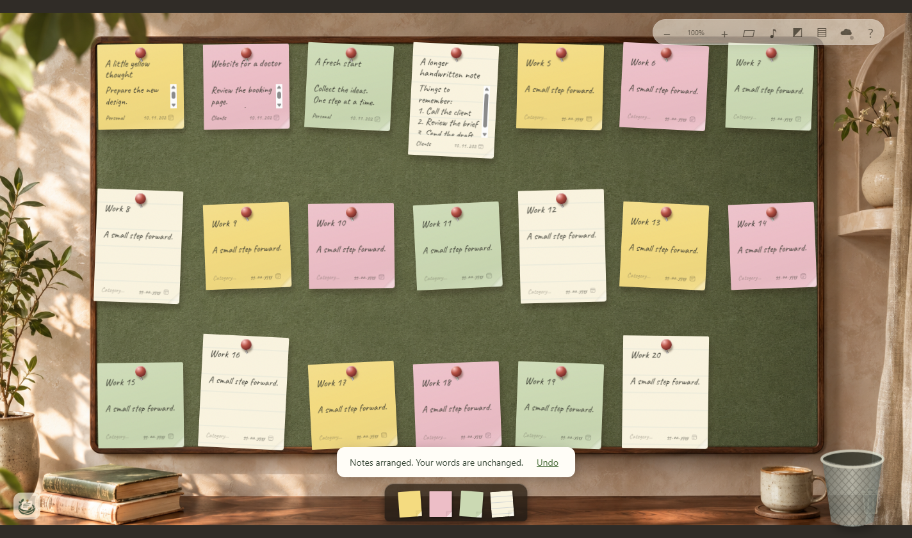

<p align="center"></p>

# NoteNest

**A little room for your thoughts.**

A free, cozy desktop note board with realistic paper, four room themes and an
optional archive in your own Google Sheets.



[Download Windows v1](https://github.com/agileguru89/NoteNest/releases/latest)
· [Report a problem](https://github.com/agileguru89/NoteNest/issues)
· [Contribute](CONTRIBUTING.md) · [Roadmap](ROADMAP.md)

## Get started

1. Download **NoteNest-Setup.exe** from Releases.
2. Install for your Windows account and open NoteNest.
3. Pick a room, then click or drag a paper from the tray.
4. Write a work/client name, to-do text, category and optional due date.
5. Drag the fastener to move a note. Finish it with the check mark.

Requires Windows 10/11 **x64**, .NET Framework 4.8 and Microsoft Edge WebView2
Runtime. The installer is currently **unsigned**; Windows may show a publisher
warning. No Python server, AI model, paid server or subscription is required.

## Your board

- Four rooms: classic cork, light linen, evening felt and sage garden.
- Yellow, pink, green and larger white lined notes.
- Pins, paper clips and tape; legible handwriting and paper shadows.
- Zoom and pan; paper size from 55% to 110%; undoable grid arrangement.
- Matching-colour crumpling and basket toss: five hits, then one miss.
  Both archive the note; undo puts it back.
- Mute and reduced-motion support.

The screenshot contains synthetic demonstration notes, not user data.


## Gentle reminders

Use the small clock on a note to choose a **local date and time**. A soft **ding-dong** is the default. The toolbar clock offers seven sounds:
ding-dong, female/male “Hey!”, female/male “Mm-hm!” and the original
female/male “Huhu”. Volume, audio preview and visual-only mode are available.
Older voice-only preferences start with ding-dong when first upgraded. The main sound mute also silences
reminders.

NoteNest must be open, including minimized. A soft card identifies the note;
View note returns to it, 10 min later snoozes it, and Dismiss stops that nudge.
Completed or blank notes never alert. Multiple notes arriving together make
one sound. Delivered reminders are recorded locally before playback so they
do not repeat on every check or restart. Missed reminders appear once when
the app next opens; closing the app disables reminders until you reopen it.
Sleep/suspend can delay a reminder until the computer resumes.

Reminder instants and reminder preferences stay in the local board and its
exported backup; the Google Sheet retains its existing date-only due column.
Existing v1.0 notes gain no reminder unless you explicitly set one.

## Optional Google Sheets archive

**Public builds work offline immediately. Google sync requires your own Desktop
OAuth client JSON in v1.** A shared publicly verified Google integration is not
included. See [Google setup](docs/GOOGLE-SETUP.md).

Notes save locally first. With Google connected, edits queue while offline.
The app creates **NoteNest — Task Archive** in your Drive; newest notes first.
Open rows are green, completed rows grey; updates use the same note ID.
Sheets is an archive, not a two-way board editor. Unchanged rows you manually
delete are not recreated by routine sync; a subsequent note edit may recreate
a record. Sync runs while the app is open. The archive stops safely near its
5,000-row capacity. Archive timestamps are labelled UTC.
Back up important notes using Export local backup.

## Privacy

Local notes: `%LOCALAPPDATA%\NoteNest\board.json`, with a previous-copy backup.
OAuth tokens: protected for your Windows user with Windows DPAPI.
No telemetry, advertising or runtime ElevenLabs API calls. Google passwords
are entered in your normal browser, never in NoteNest. The app requests basic
identity plus `drive.file`, not every Drive file. See [Privacy](PRIVACY.md).

## Build and test

On Windows with .NET Framework 4.8 and WebView2 Runtime:

```powershell
powershell -ExecutionPolicy Bypass -File .\setup-deps.ps1
powershell -ExecutionPolicy Bypass -File .\build.ps1
node test-model.cjs
node test-reminders.cjs
.\release\NoteNest.exe --selftest
```

Node is needed only for model tests. setup-deps.ps1 downloads and SHA-256-checks
the pinned official WebView2 SDK. The installer and portable ZIP are created
in the project root. See [Testing](docs/TESTING.md).

## macOS contributors welcome

**v1 is Windows-only. No Mac build has been tested or released.**
The HTML/CSS/JavaScript board can be reused. The WinForms/WebView2 host,
Windows DPAPI storage, OAuth callback and installer need macOS equivalents.
Please discuss a port in Issues before a large rewrite.

## License and credits

Source and documentation: [MIT](LICENSE).
Art, audio, branding and dependencies: [separate terms](ASSETS-LICENSE.md).
Caveat font (SIL OFL). Artwork generated for NoteNest; effects generated once
with ElevenLabs. See [audio production notes](AUDIO-PROMPTS.md).
The NoteNest name has not undergone trademark clearance.
